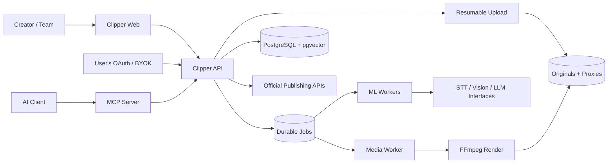
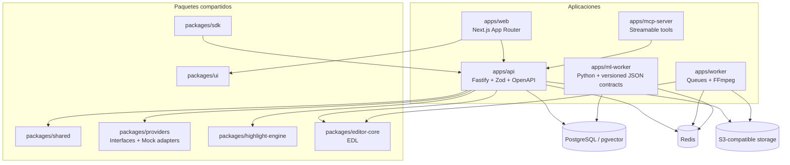
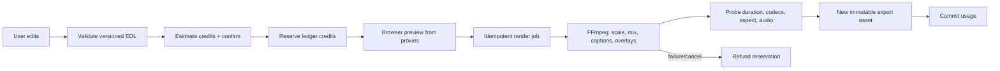
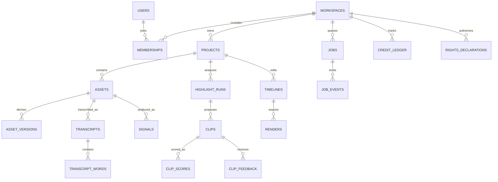

# Arquitectura de Clipper.ai v3

Clipper procesa material aportado por el usuario para encontrar momentos compartibles, editar audio/video y publicar exportaciones. Los originales permanecen inmutables. Los cortes, subtítulos, capas y transformaciones viven en una EDL versionada y se renderizan como nuevos assets.

## Contexto del sistema



## Contenedores y paquetes



## Pipeline de highlights

```mermaid
sequenceDiagram
  participant U as User
  participant A as API
  participant Q as Job Queue
  participant W as Media Worker
  participant M as ML Workers
  participant P as Provider Registry
  participant D as PostgreSQL / Storage
  U->>A: Upload asset + rights declaration
  A->>A: Validate type, size, ownership, estimate cost
  A->>Q: Create resumable highlight_run
  Q->>W: Proxy 720p + extract audio/keyframes
  W->>D: Store immutable original and derived proxy
  W->>M: Dispatch timestamped analysis tasks
  M->>P: Call STT / vision / LLM interface
  P-->>M: Mock or configured provider result
  M->>D: Persist words, speakers, signals and embeddings
  M->>M: Build boundaries, score, diversify, explain
  M->>D: Save clips; never split word or sentence boundaries
  D-->>U: Progress events and ranked results
```

Each score is a heuristic with component breakdown and one-sentence reason. It does not imply a promise of virality. Provider/model choices and their capabilities, limits, and costs come from configuration, not UI constants.

## Pipeline de render y EDL



The EDL stores track order, source asset, in/out time, timeline position, transforms, gain and caption styling. Undo/redo and autosave append versions. The renderer reads source media and emits a separate output; it never rewrites the source.

## Data model draft



Use PostgreSQL for transactional state, pgvector for semantic retrieval, Redis for queue coordination, and S3-compatible storage for originals, proxies, and immutable export assets. Partition high-volume jobs/events/ledger by month when volume justifies it.

## Operational boundaries

- External STT, voice, LLM, vision, music and publishing services implement typed provider interfaces and have a functional Mock adapter.
- Long workflows support idempotency, retries, resume and dead-letter handling.
- Rights declarations precede processing; signed URLs expire; uploads have size/type limits and scanning.
- Never scrape or download from social networks; use direct file URLs and official user-authorized OAuth APIs.
- Persist timestamps in UTC. Keep provider keys encrypted and backend-only.
